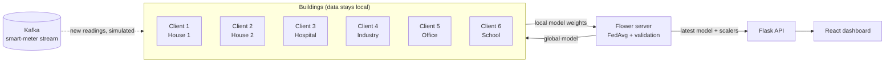

# Federated Learning for Multi-Building Energy Forecasting

Privacy-preserving forecasting of building energy consumption with **federated learning**.
Six buildings (two houses, a hospital, an industrial site, an office, and a school) jointly train a
shared forecasting model **without sharing their raw smart-meter data**: each building trains locally
and only sends model weights to a central server, which aggregates them with Federated Averaging.

The system runs as a set of Docker containers (a Flower server, six clients, and a Kafka stream that
simulates live smart-meter readings). A Flask API and a React dashboard serve forecasts from the latest
global model.

This was my undergraduate final-year project (BS Artificial Intelligence, PAF-IAST, 2025).

---

## Architecture



**One federated round**

1. The server sends the current global model and the training config (epochs, batch size, round) to all six clients.
2. Each client trains the model on its own building's newest data slice and returns the updated weights.
3. The server computes a **sample-weighted average** of the client weights (FedAvg).
4. The new global model is evaluated on a held-out community dataset (MSE, RMSE, MAE, MAPE).
5. The model and its input scalers are saved for the dashboard. Training stops updating the model if
   validation MSE does not improve for 5 rounds (early stopping).

To simulate streaming data, every new 5-minute data slice is used for 2 rounds before clients move to the next slice.

## Model

The default **Hybrid** model (`trainer/model/model.py`) has two branches:

| Branch | Input | Layers |
|---|---|---|
| Temporal | last 72 hourly consumption values | LSTM(64) → Dropout |
| Exogenous | 11 features: season (4 one-hot), outdoor temperature, humidity, cloud cover, occupancy, special-equipment, lighting and HVAC load | Dense(32) → Dropout → Dense(16) |

The two branches are concatenated and followed by Dense(32) → Dense(1) to predict consumption (kW).
LSTM, Transformer, MLP and XGBoost variants can be selected with `MODEL_TYPE` in `trainer/config.py`.

The dashboard backend produces multi-hour forecasts by feeding each prediction back into the
72-hour history window (iterative forecasting).

## Repository structure

```
trainer/                      Federated learning system (run with Docker Compose)
├── config.py                 Shared settings (model type, rounds, clients, epochs)
├── model/model.py            Model definitions, preprocessing, training, metrics
├── server/server.py          Flower server: FedAvg, validation, early stopping, checkpointing
├── client/client.py          Flower client: one building, trains on local data only
├── realtime_producer.py      Kafka producer streaming new readings per building
├── datasets/                 Per-building data and held-out community validation data
└── docker-compose.yaml       Server, 6 clients, Kafka, Zookeeper, producer

app/
├── backend/app.py            Flask API: /predict, /consumption, /metrics
└── energy-dashboard-vision-main/   React + TypeScript dashboard

data_preparation/
└── preprocessing.ipynb       Cleaning and feature engineering of the raw building datasets
```

## Running the project

**Requirements:** Docker with Docker Compose, Python 3.11, Node.js 18+.

### 1. Federated training

```bash
cd trainer
docker compose up --build
```

This starts Kafka, the producer, the Flower server and the six clients. The server prints validation
metrics after every round and writes the latest global model, scalers and `metrics_history.csv` to
`app/backend/prediction_model_files_docker/`.

### 2. Backend API

```bash
cd app/backend
pip install -r requirements.txt
python app.py            # serves on http://localhost:5001
```

| Endpoint | Description |
|---|---|
| `POST /predict` | Forecast consumption `hours_ahead` hours ahead from operator-provided weather/occupancy inputs |
| `GET /consumption` | Hourly or daily consumption for a building and date range |
| `GET /metrics` | Total consumption, peak demand, peak hour and average for a building and date range |

### 3. Dashboard

```bash
cd app/energy-dashboard-vision-main
npm install
npm run dev              # http://localhost:5173
```

## Configuration

Main settings in `trainer/config.py`:

| Setting | Default | Meaning |
|---|---|---|
| `MODEL_TYPE` | `Hybrid` | Model architecture |
| `NUM_CLIENTS` | 6 | Number of buildings in the federation |
| `ROUNDS_PER_SLICE` × `NUM_SLICES` | 2 × 10 | Total federated rounds |
| `EPOCHS`, `BATCH_SIZE` | 3, 32 | Local training per round |
| `SEQUENCE_LENGTH` | 72 | Hours of history used by the LSTM branch |

## Known limitations and next steps

- In the streaming simulation, each client trains on its newest reading only, with the history window
  filled by that reading. Keeping a sliding window of recent history on each client would give more
  stable local updates.
- Clients currently read their new data slices from the same `future_*.csv` files that the producer
  publishes; consuming them directly from the Kafka topic is the next step.
- Model weights are sent to the server in plaintext. In follow-up research, I implemented secure
  aggregation (additive secret sharing with AES encryption and Diffie–Hellman key exchange) so that
  the server cannot see individual building updates.

## Related publication

F. Hamayat, H. Ali, M. Driss, and J. S. Khan, "Edge-Enabled Federated Learning for Predictive Energy
Modeling in Multi-Building Systems," *2025 International Joint Conference on Neural Networks (IJCNN)*,
Rome, Italy, 2025. [doi:10.1109/IJCNN64981.2025.11228150](https://doi.org/10.1109/IJCNN64981.2025.11228150)

## License

MIT, see [LICENSE](LICENSE).
